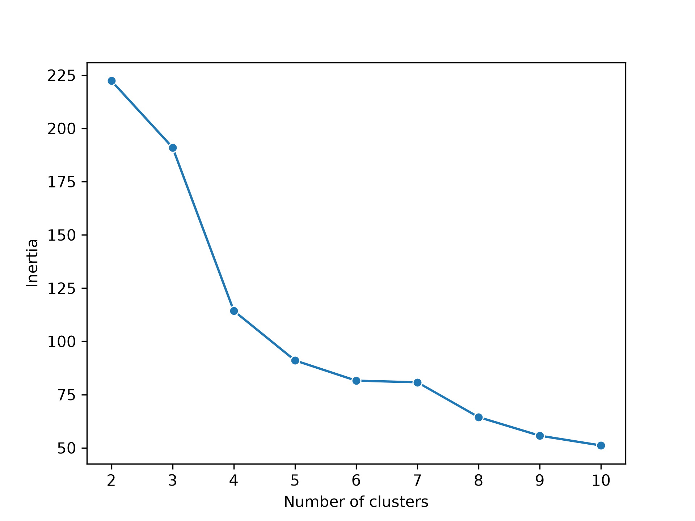
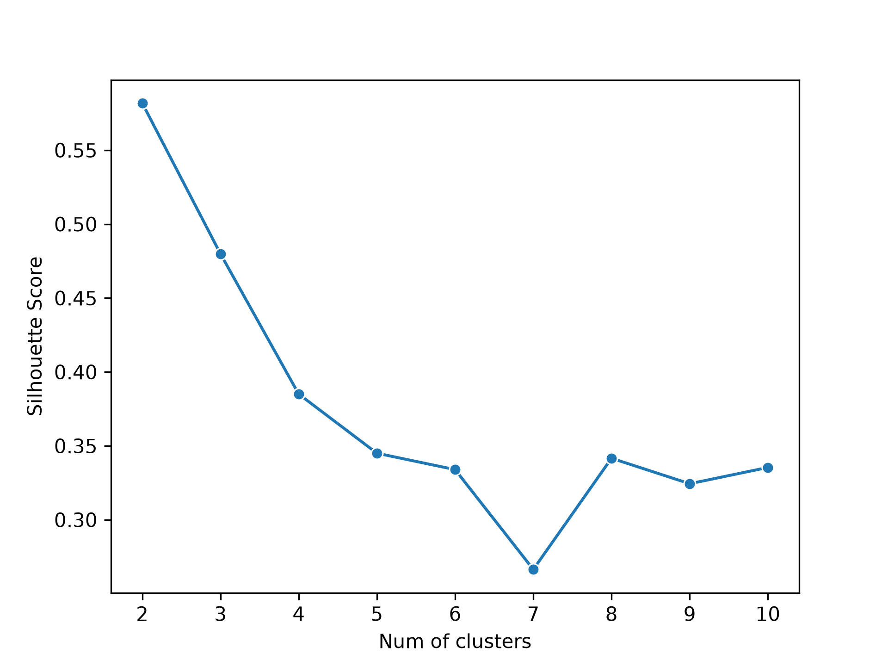
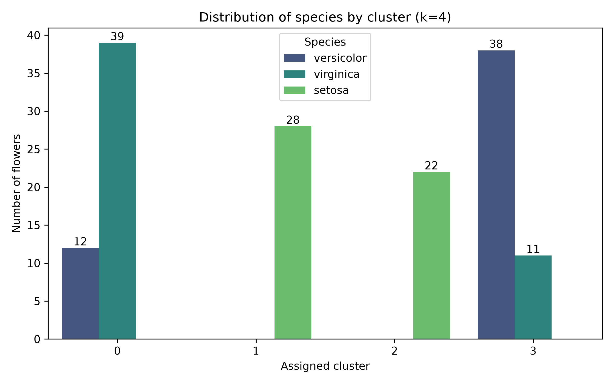

# 🌸 Iris Species Segmentation with K-Means Clustering

An **Unsupervised Machine Learning** project in Python using `scikit-learn`, `pandas`, and `seaborn` to uncover natural groupings within the classic *Iris* dataset based solely on physical measurements (sepal and petal dimensions), without exposing the species labels during training.

## 🛠️ Tech Stack
* **Python 3**
* **Pandas & NumPy** (data manipulation and numerical analysis)
* **Scikit-Learn** (`StandardScaler`, `KMeans`, `silhouette_score`)
* **Matplotlib & Seaborn** (data visualization)

## 📊 Methodology & Results

### 1. Selecting the Optimal Number of Clusters (`k`)
Features were first standardized using `StandardScaler` (mean = 0, standard deviation = 1) to ensure fair Euclidean distance calculations. Models ranging from `k = 2` to `k = 10` were then evaluated using both the **Elbow Method (Inertia)** and the **Silhouette Score**:

* **Inertia (Elbow Method):** Shows a sharp drop up to `k = 4` (from ~222.36 down to ~114.35), where the curve begins to flatten.
* **Silhouette Score:** Confirms `k = 4` (~0.385) as a solid balance between cluster compactness and separation before scores drop further at higher values.





### 2. Cluster Validation vs. Actual Species
Cross-referencing the 4 predicted clusters against the ground-truth `species` labels revealed strong alignment with real biological traits:
* **100% separation of *Setosa*:** All 50 *Setosa* samples were isolated exclusively into **Clusters 1 and 2**, naturally subdivided by sepal size.
* **Clear grouping of *Versicolor* and *Virginica*:** **76%** of *Versicolor* (38/50) grouped into **Cluster 3**, while **78%** of *Virginica* (39/50) grouped into **Cluster 0**, with minor overlap in boundary measurements.



## 💡 Key Takeaways
* **Feature scaling is mandatory:** Without `StandardScaler`, features with larger numerical ranges would disproportionately skew K-Means distance calculations.
* **Metrics + Domain Knowledge:** Mathematical metrics (inertia and silhouette) provide essential guidance for hyperparameter tuning, but combining them with domain context is critical to properly interpret the resulting segments.

## 🚀 How to Run Locally
1. Clone this repository:
   ```bash
   git clone https://github.com
   ```
2. Install the required dependencies:
   ```bash
   pip install pandas numpy scikit-learn matplotlib seaborn
   ```
3. Run the Python script:
   ```bash
   python your_script.py
   ```
